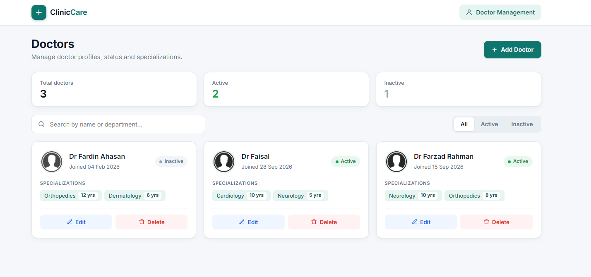
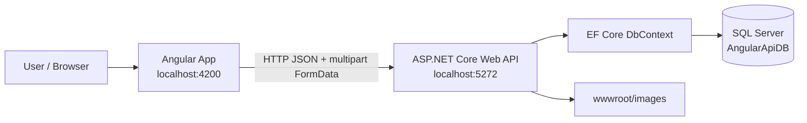
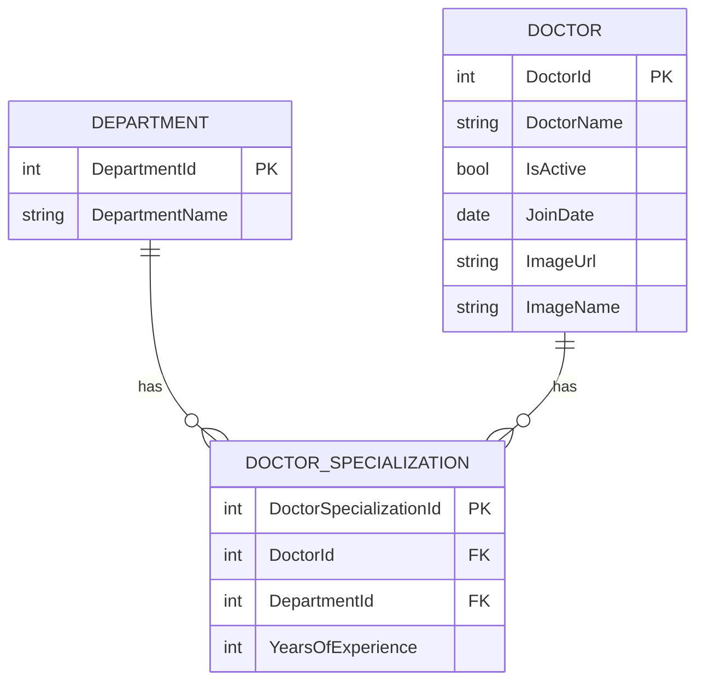

<div align="center">

# 🏥 ClinicCare

### Doctor Management System · ASP.NET Core 9 Web API + Angular

**A full stack application for managing doctor profiles, status, and specializations, built with a RESTful ASP.NET Core Web API (EF Core + SQL Server) and a signal-based Angular frontend.**

[](https://dotnet.microsoft.com/)
[](https://learn.microsoft.com/aspnet/core/web-api/)
[](https://learn.microsoft.com/ef/core/)
[](https://learn.microsoft.com/sql/sql-server/)
[](https://angular.dev/)
[](https://www.typescriptlang.org/)
[](https://getbootstrap.com/)
[](https://swagger.io/)

[**Features**](#-key-features) · [**Architecture**](#-architecture) · [**Getting Started**](#-getting-started) · [**API Reference**](#-api-reference)

</div>

---

## 📖 Overview

**ClinicCare** is a full stack doctor management application. The **ASP.NET Core 9 Web API** exposes CRUD endpoints for doctors and departments, stores data in **SQL Server** through **Entity Framework Core**, and saves uploaded doctor photos on the server. The **Angular** frontend consumes the API and provides a card-based dashboard with search, status filtering, live counters, and a slide-in drawer form for adding and editing doctors.

A doctor can have **multiple specializations**. Each specialization links a doctor to a department and records the **years of experience**.

> **Project scope:** This is a learning/portfolio project demonstrating full stack development with ASP.NET Core and Angular. It is **not** a production-ready healthcare system.

## 📸 Screenshot

<div align="center">



</div>

## ✨ Key Features

| Module                 | Capabilities                                                                                                                                                       |
| ---------------------- | ------------------------------------------------------------------------------------------------------------------------------------------------------------------ |
| **Doctor management**  | Create, view, update, and delete doctors with name, join date, and active/inactive status.                                                                         |
| **Specializations**    | Add or remove multiple specializations per doctor, each with a department and years of experience, using a dynamic Reactive Forms `FormArray`.                     |
| **Image upload**       | Upload a doctor photo with live preview. Files are stored under `wwwroot/images` with GUID-based names; a default `noimage.png` is used when no photo is provided. |
| **Image lifecycle**    | The old image file is deleted when a doctor's photo is replaced or when the doctor is deleted.                                                                     |
| **Dashboard counters** | Total, active, and inactive doctor counts calculated reactively with Angular `computed` signals.                                                                   |
| **Search**             | Filter by doctor name or department name.                                                                                                                          |
| **Status filter**      | Switch between All, Active, and Inactive doctors.                                                                                                                  |
| **Validation**         | Required fields and minimum values on the form; the API verifies that every submitted department exists and returns a clear `400` message on invalid JSON.         |
| **API documentation**  | Swagger UI available in the Development environment.                                                                                                               |

## 🧰 Technology Stack

| Layer                  | Technology                                                                                       |
| ---------------------- | ------------------------------------------------------------------------------------------------ |
| **Frontend framework** | Angular (standalone components, no NgModules)                                                    |
| **Frontend patterns**  | Signals, `computed`, Reactive Forms, `FormArray`, `inject()`, HttpClient, service layer, routing |
| **UI**                 | Bootstrap 5 and custom CSS                                                                       |
| **Backend**            | ASP.NET Core Web API on **.NET 9** (C#)                                                          |
| **Data access**        | Entity Framework Core **9.0.20** (Code-First with Migrations)                                    |
| **Database**           | Microsoft SQL Server (SQL Server LocalDB by default)                                             |
| **Serialization**      | Newtonsoft.Json with reference-loop handling for nested relations                                |
| **API docs**           | Swashbuckle / Swagger UI                                                                         |
| **Tools**              | Visual Studio / VS Code, Node.js, npm, Angular CLI, .NET CLI, Git                                |

## 🏗️ Architecture



### Data Model



`Doctor` and `Department` form a **many-to-many** relationship through `DoctorSpecialization`, which also stores `YearsOfExperience`.

### How a doctor is saved

1. The Angular form builds a `FormData` object containing `DoctorName`, `IsActive`, `JoinDate`, the optional `ImageFile`, and a `SpecializationsJson` string (for example `[{"departmentId":1,"yearsOfExperience":3}]`).
2. The API binds it to `DoctorDTO` with `[FromForm]`, saves the image, parses and validates the specializations, and persists the doctor with its specializations in one `SaveChanges` call.
3. On update, the existing specializations are removed and replaced with the submitted list.

## 📁 Project Structure

```text
cliniccare-fullstack/
├── HospitalManagementAPI_backend/              # ASP.NET Core 9 Web API
│   ├── HospitalManagementAPI.sln
│   └── HospitalManagementAPI/
│       ├── Controllers/
│       │   └── DoctorsController.cs            # CRUD + departments + image handling
│       ├── Models/
│       │   ├── Doctor.cs                       # Doctor entity
│       │   ├── HospitalDbContext.cs            # EF Core DbContext
│       │   └── DTOs/
│       │       └── DoctorDTO.cs                # Form-data DTO
│       ├── Migrations/                         # EF Core migrations
│       ├── Properties/launchSettings.json
│       ├── wwwroot/images/                     # Uploaded doctor photos
│       ├── Program.cs                          # DbContext, CORS, Swagger, JSON setup
│       └── appsettings.json
│
├── resume-doctor_frontend/                     # Angular application
│   ├── src/app/
│   │   ├── components/
│   │   │   └── doctors.componets/              # Doctor dashboard + drawer form
│   │   ├── models/                             # doctor, department, doctor-specialization, doctor-dto
│   │   ├── service/
│   │   │   └── doctor.service.ts               # API communication
│   │   ├── app.routes.ts                       # '' → /doctors
│   │   └── app.config.ts
│   ├── angular.json
│   └── package.json
│
├── screenshots/
├── .gitignore
└── README.md
```

## 🚀 Getting Started

### Prerequisites

- **.NET 9 SDK**
- **Node.js** (LTS) and **npm**
- **Angular CLI**: `npm install -g @angular/cli`
- **SQL Server** or **SQL Server LocalDB**
- **EF Core CLI tools**: `dotnet tool install --global dotnet-ef`
- **Visual Studio 2022** or **VS Code**

### 1. Clone the repository

```bash
git clone https://github.com/FardinAhasanDev/cliniccare-fullstack.git
cd cliniccare-fullstack
```

### 2. Run the backend

```bash
cd HospitalManagementAPI_backend/HospitalManagementAPI
```

The connection string is stored under the key `con` in `appsettings.json`:

```json
{
  "ConnectionStrings": {
    "con": "server=(LocalDB)\\MSSQLLocalDB; database=AngularApiDB; Trusted_Connection=true; MultipleActiveResultSets=true;"
  }
}
```

Update the server or database name if your environment is different, then create the database and start the API:

```bash
dotnet ef database update
dotnet run
```

The API listens on **http://localhost:5272** (confirm in `Properties/launchSettings.json`). In the Development environment, Swagger UI is available at **http://localhost:5272/swagger**.

> **Departments data:** the form needs at least one record in the `Departments` table (for example Cardiology, Neurology, Orthopedics). If the table is empty after migrating, insert a few departments before adding doctors.

### 3. Run the frontend

Open a **second terminal**:

```bash
cd resume-doctor_frontend
npm install
ng serve
```

Open **http://localhost:4200**. The root URL redirects to the doctors page.

> The API base URL (`http://localhost:5272/api/Doctors`) is currently set in `src/app/service/doctor.service.ts`, and the image base URL in `doctors.componets.ts`. Update both if your backend runs on a different port.

## 🔌 API Reference

Base URL: `http://localhost:5272/api/Doctors`

| Method   | Endpoint                   | Description                                           | Success response |
| -------- | -------------------------- | ----------------------------------------------------- | ---------------- |
| `GET`    | `/api/Doctors`             | List all doctors with specializations and departments | `200 OK`         |
| `GET`    | `/api/Doctors/departments` | List all departments                                  | `200 OK`         |
| `GET`    | `/api/Doctors/{id}`        | Get one doctor by id                                  | `200 OK` / `404` |
| `POST`   | `/api/Doctors`             | Create a doctor (`multipart/form-data`)               | `200 OK`         |
| `PUT`    | `/api/Doctors/{id}`        | Update a doctor (`multipart/form-data`)               | `204 No Content` |
| `DELETE` | `/api/Doctors/{id}`        | Delete a doctor and its image                         | `204 No Content` |

### Create / update form fields

| Field                 | Type             | Notes                                         |
| --------------------- | ---------------- | --------------------------------------------- |
| `DoctorName`          | text             | Required                                      |
| `IsActive`            | `true` / `false` | Doctor status                                 |
| `JoinDate`            | `yyyy-MM-dd`     | Join date                                     |
| `ImageFile`           | file             | Optional; defaults to `noimage.png` on create |
| `SpecializationsJson` | JSON text        | See example below                             |
| `DoctorId`            | number           | Required on `PUT`; must match the route id    |

```json
[
  { "DepartmentId": 1, "YearsOfExperience": 10 },
  { "DepartmentId": 2, "YearsOfExperience": 5 }
]
```

An unknown `DepartmentId` returns `400 Bad Request` with the message `Department not exists`.

## 🧠 Concepts Demonstrated

- **Full stack integration:** An Angular SPA consuming an ASP.NET Core REST API across two origins with CORS.
- **EF Core Code-First:** Migrations, eager loading with `Include` / `ThenInclude`, and a many-to-many relationship with payload (`YearsOfExperience`).
- **DTO pattern:** `DoctorDTO` separates the API input contract from the database entity.
- **File upload handling:** `IFormFile` with GUID filenames and cleanup of replaced or deleted images.
- **Mixed payloads:** Sending a file and a JSON child list together in one `multipart/form-data` request.
- **Modern Angular:** Standalone components, signals, `computed`, `inject()`, and Reactive Forms with a dynamic `FormArray`.
- **API documentation:** Swagger UI for testing endpoints in the browser.

## 🔐 Security & Production Considerations

This repository is a demonstration project. Before using it with real data, consider:

1. **Authentication and authorization:** Add login and role-based access (for example ASP.NET Core Identity with JWT).
2. **CORS policy:** The current policy allows any origin, header, and method. Restrict it to trusted origins in production.
3. **Upload validation:** Enforce server-side file type, size, and content checks for uploaded images.
4. **Configuration:** Move the API base URL in the Angular app to environment files, and keep production connection strings in secrets or environment variables.
5. **Validation and error handling:** Add server-side model validation, a global exception handler, and user-facing error messages in the UI.
6. **Image storage:** Uploaded images live in `wwwroot/images`. Do not commit real patient or doctor photos to a public repository.
7. **Automated tests:** Add unit and integration tests for the controller and Angular components.

## 🗺️ Roadmap

- [ ] JWT authentication and role-based authorization
- [ ] Patient management module
- [ ] Appointment booking
- [ ] Prescription management
- [ ] Pagination and server-side search
- [ ] Image validation and optimization
- [ ] Angular environment configuration
- [ ] Unit and integration tests
- [ ] Docker support and CI pipeline

## 👨‍💻 Author

**Fardin Ahasan**
GitHub: [@FardinAhasanDev](https://github.com/FardinAhasanDev)

---

<div align="center">

**ClinicCare** · Built to demonstrate practical full stack development with ASP.NET Core and Angular.

⭐ If you find this project useful, consider giving it a star.

</div>
